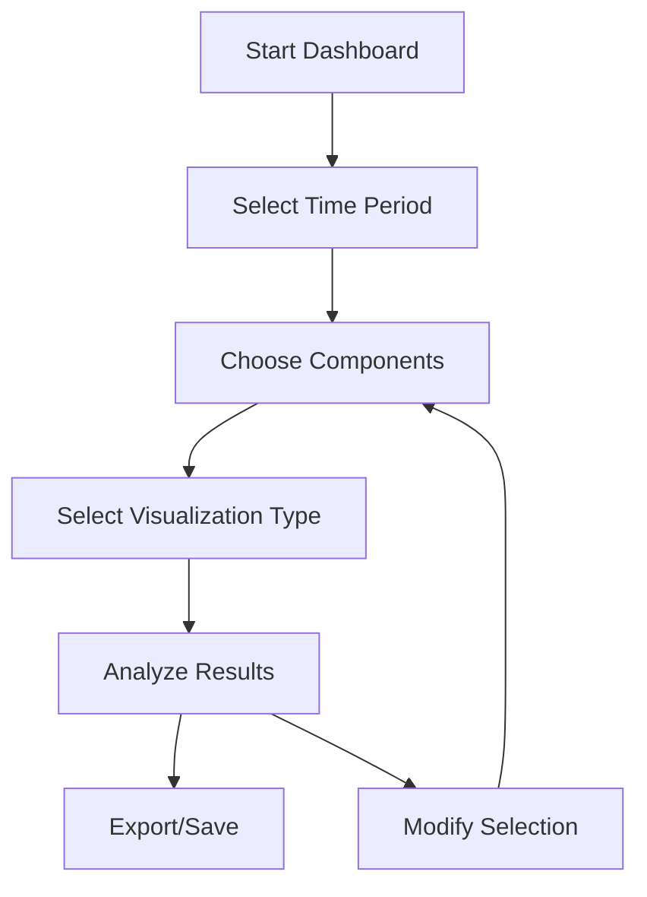

# Dashboard Overview

The QWIM Dashboard provides comprehensive portfolio analysis tools with interactive visualizations and real-time data filtering capabilities.

## Main Interface

### Navigation Structure

The dashboard uses a tabbed interface with the following sections:

=== "QWIM Portfolios"
    Primary analysis interface for portfolio weight distribution and component analysis.

=== "About"
    Application information, version details, and feature overview.

### Layout Components

!!! info "Dashboard Layout"
    - **Left Sidebar**: Controls and filters
    - **Main Area**: Visualizations and analysis
    - **Responsive Design**: Adapts to screen size

## Key Features

### Real-Time Analysis

- **Interactive Visualizations**: Plotly-powered charts with zoom, pan, and hover
- **Dynamic Filtering**: Component selection with immediate updates
- **Time Period Controls**: Flexible date range selection
- **Statistical Analysis**: Comprehensive metrics for selected components

### User Interface Elements

| Component | Purpose | Location |
|-----------|---------|----------|
| **Time Period Selection** | Filter data by date ranges | Left sidebar |
| **Component Selection** | Choose ETF components for analysis | Left sidebar |
| **Visualization Options** | Chart type and display settings | Left sidebar |
| **Data Information** | Current selection summary | Left sidebar |
| **Main Chart** | Primary time series visualization | Main area |
| **Composition Chart** | Current portfolio breakdown | Main area |
| **Statistics Table** | Numerical analysis summary | Main area |

## Workflow Overview

### Standard Analysis Workflow

### Interactive Updates

!!! success "Real-Time Synchronization"
    All dashboard components are synchronized:
    
    - Change component selection → All charts update
    - Modify time period → Data refreshes automatically
    - Switch visualization → Charts redraw instantly
    - Toggle percentage view → Statistics recalculate

## Navigation Guide

### Getting Started

1. **Access the dashboard** at the configured URL
2. **Select QWIM Portfolios tab** (default view)
3. **Review default settings**:
   - Time Period: Last 5 Years
   - Components: First 3 ETFs selected
   - Visualization: Stacked Area Chart

### Basic Operations

=== "Time Period Selection"
    **Preset Options:**
    - Last 1 Year, 3 Years, 5 Years, 10 Years
    - Year to Date (YTD)
    - Custom date range
    
    **Usage:**
    - Select from dropdown
    - For custom: choose start and end dates
    - Changes apply immediately

=== "Component Selection"
    **Features:**
    - Individual ETF checkboxes
    - "Select All ETFs" toggle
    - Real-time count display
    
    **Behavior:**
    - Default: First 3 components selected
    - Multiple selection supported
    - Immediate visualization updates

=== "Visualization Options"
    **Chart Types:**
    - Stacked Area: Portfolio composition flow
    - Line Chart: Individual component trends
    - Stacked Bar: Discrete time comparisons
    - Heatmap: Pattern and correlation analysis
    
    **Display Options:**
    - Show as Percentage toggle
    - Sort Components by Weight
    - Full-screen chart mode

## Advanced Features

### Statistical Analysis

The dashboard provides comprehensive statistics for selected components:

| Metric | Description | Use Case |
|--------|-------------|----------|
| **Latest** | Most recent weight value | Current allocation |
| **Average** | Historical mean weight | Typical allocation |
| **Min/Max** | Extreme weight values | Range analysis |
| **StdDev** | Standard deviation | Volatility assessment |

### Export Capabilities

!!! tip "Export Options"
    - **PNG Export**: High-quality chart images
    - **Table Export**: Statistical data
    - **Real-time Sync**: Exports reflect current selection

### Performance Features

- **Automatic Downsampling**: Large datasets optimized for performance
- **Lazy Loading**: Charts load only when needed
- **Responsive Updates**: Smooth transitions and animations
- **Memory Efficient**: Optimized data structures

## User Experience

### Responsive Design

The dashboard adapts to different screen sizes:

- **Desktop**: Full sidebar and main area layout
- **Tablet**: Collapsible sidebar with maintained functionality
- **Mobile**: Stacked layout with touch-friendly controls

### Accessibility

!!! info "Accessibility Features"
    - **Keyboard Navigation**: Full keyboard support
    - **Screen Reader Compatible**: Proper ARIA labels
    - **High Contrast**: Clear visual hierarchy
    - **Responsive Text**: Scalable fonts and UI elements

### Error Handling

The dashboard includes comprehensive error handling:

- **Data Validation**: Input validation with user feedback
- **Graceful Degradation**: Fallback displays for missing data
- **Error Messages**: Clear, actionable error descriptions
- **Recovery Options**: Automatic retry and reset capabilities

## Customization Options

### Theme Selection

The dashboard uses the Flatly Bootstrap theme providing:

- **Professional Appearance**: Clean, modern design
- **Consistent Colors**: Blue primary with indigo accents
- **Readable Typography**: Roboto font family
- **Interactive Elements**: Hover states and transitions

### Layout Preferences

Users can customize their experience through:

- **Chart Size**: Full-screen mode for detailed analysis
- **Sidebar Position**: Collapsible for more chart space
- **Table Display**: Expandable statistics view

## Next Steps

Explore specific features:

- [Portfolios tab in QWIM dashboard](tab-portfolios.md) - Detailed portfolio analysis
- [Investors tab in QWIM dashboard](tab-investors.md) - Detailed investor information
- [Data Filtering](data-filtering.md) - Advanced filtering techniques  
- [Export Features](export.md) - Saving and sharing analysis